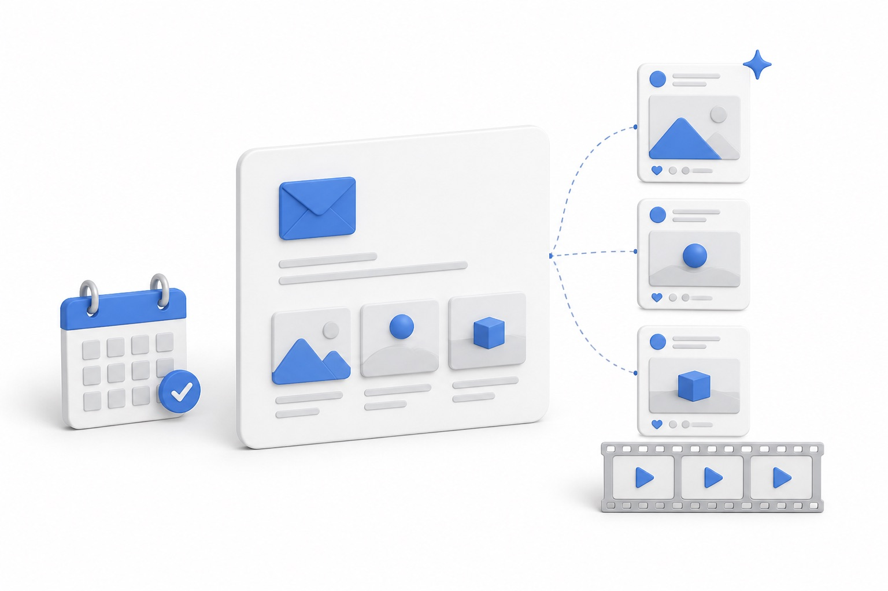
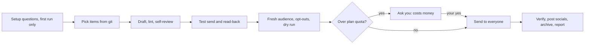

# product-changelog

<p align="center">
  
</p>

<p align="center">
  <b>Your changelog email and social posts, written and sent from git</b>
</p>

<p align="center">
  
  
  
</p>

A [Claude Code](https://claude.com/claude-code) skill that writes and sends your recurring product changelog email, then turns it into an X thread, a LinkedIn post and a Discord or Slack announcement. Optionally it outlines an animated changelog video from the same screenshots.

It is opinionated about the craft: what goes in, how it reads, and how to send it without ever emailing someone who opted out. It asks you a few setup questions once, then runs each issue end to end on its own. The only thing it asks permission for is spending money.

## What it does

- **Picks the content.** Reads your git log and release notes since the last issue, keeps only user-visible changes, and proposes 3 to 5 items ranked by how useful they are to your users.
- **Writes like a person.** Benefit-led subject, one-line opener, flowing sentences instead of labeled bullets, one bold accent per paragraph, no "excited to announce". Your voice notes in config override the defaults.
- **Screenshots.** A Playwright recipe for crisp 2x captures of the exact panel, hosted before you send.
- **Sends safely.** Lint, test send to your own addresses, read the delivered test back through the provider API, dry run with counts, then the real send. Opt-outs are filtered every time, and an unsubscribed contact is never resubscribed by accident.
- **Social posts.** X thread (hook tweet with no link, one numbered tweet per item), LinkedIn post, short community announcement. Posted for you when you configure a posting tool per channel, otherwise handed over as final text.
- **Video (optional).** Style guide and a minimal Remotion outline for a 20 second motion recap.
- **Archive.** One folder per issue, so the newest issue is always the template for the next.

## Requirements

- Claude Code
- Python 3.9 or newer, plus PyYAML (`pip install pyyaml`). Everything else is the standard library.
- A [Resend](https://resend.com) account with a verified sending domain, for sending. Other providers work by swapping the small `Resend` class in `scripts/_common.py`.
- Optional: Node and [Playwright](https://playwright.dev) for screenshots, [Remotion](https://www.remotion.dev) for the video (check its license for your company size).

## Install

```bash
git clone https://github.com/mariagorskikh/product-changelog ~/.claude/skills/product-changelog
pip install pyyaml
```

## Configure

```bash
cp ~/.claude/skills/product-changelog/config.example.yaml ./config.yaml
export RESEND_API_KEY=...            # never put keys in config.yaml
export UNSUBSCRIBE_SECRET=...        # only for unsubscribe.mode: own_endpoint
```

Fill in `config.yaml`: product name and URLs, sender name and address, test recipients, brand colors, voice notes, banned phrases, the Resend audience ID, and where screenshots are hosted. If you skip this, Claude asks for the missing values once, in one batch, on the first run. `config.yaml` is gitignored.

Three settings shape how much it does on its own:

- `autonomy.mode`: `autonomous` (default) runs the whole issue and reports after; `review` stops for your okay before the test send, the real send and each post.
- `provider.monthly_quota`: the emails your plan includes per month. A send that would go over it waits for your yes, because it costs money.
- `social.post_via`: the tool Claude uses to post each channel (an MCP server, a CLI, a webhook). Empty means it hands you the text.

Two unsubscribe modes:

- `broadcast`: Resend hosts the unsubscribe page and handles suppression. Easiest.
- `own_endpoint`: you host the page; the scripts mint a signed, personal link per address and add one-click `List-Unsubscribe` headers.

## Example prompts

- "Write the next changelog email."
- "What shipped since the last changelog? Propose the items."
- "Send me a test of the changelog."
- "Do this week's changelog." (runs the whole issue)
- "Draft the X thread and LinkedIn post for this changelog."
- "Make a changelog video from these screenshots."
- "How many people get the changelog, and how many unsubscribed last issue?"

## How it works



1. On the first run Claude asks the setup questions in one batch and writes `config.yaml`. Later issues ask nothing (at most an optional "anything shipped outside git?").
2. It reads the last issue, picks 3 to 5 user-visible changes from git and release notes, and drafts `subject.txt`, `email.html` and `email.txt`.
3. **Self-review gate:** `lint_email.py` checks banned phrases, dashes, leftover placeholders, alt text, the unsubscribe line and every link. Claude then re-reads the email as a customer would and checks every claim against the live site.
4. `send_test.py --send` mails only your test recipients, and `--readback` fetches the delivered copies from the provider API to confirm they rendered.
5. Claude builds the audience fresh, filters opt-outs and runs a dry run. If the send would go over your plan's quota, it stops and asks you. Otherwise it passes the send flag itself.
6. It verifies delivery, pulls opt-outs back, posts the social posts where you set up a tool, archives the issue and sends you one report with everything that went out.

Every script is a dry run unless you pass an explicit flag. In autonomous mode Claude passes those flags after the self-review gate; set `autonomy.mode: review` to approve each step yourself.

## Safety

| It does on its own | It never does |
| --- | --- |
| Test sends to your own addresses | Email anyone who opted out, or resubscribe them |
| The real send, after lint, read-back and a dry run | Spend money (over-quota sends, plan upgrades, paid tools) without your yes |
| Pull opt-outs back after the send | Keep sending when provider errors pile up (it stops; the blast is resumable) |
| Post socials through tools you configured | Work around a login prompt, CAPTCHA or platform warning |
| Archive the issue and report | Invent a feature, number or date |

Sending to your whole user base without a human looking first is a real risk. The gates are strict, but if a wrong email would hurt you, start with `mode: review` for a few issues. Posting through automation tools must also follow each platform's terms; X and LinkedIn limit automated posting, so check yours before you configure `social.post_via`.

## What's in the box

```
product-changelog/
  SKILL.md                    the workflow Claude follows
  config.example.yaml         every company-specific value, with placeholders
  templates/
    email.html                styled-minimal email layout
    email.txt                 plain text twin
  scripts/
    _common.py                config, Resend client, first-name cleaning, signed unsubscribe links
    lint_email.py             copy and link checks; exits 1 on failure
    send_test.py              test send to your own addresses, plus --readback (dry run by default)
    blast.py                  one-by-one send with opt-out filtering, quota check, error stop, resumable
    broadcast_sync.py         upsert contacts into a Resend audience, never resubscribes
    broadcast_create.py       create a broadcast draft; send only with an explicit flag
    broadcast_unsubs.py       pull opt-outs from Resend into a local list
    verify_delivery.py        spot-check delivery of a blast
  references/
    voice-and-format.md       picking items, subject lines, sentences, styling
    screenshots.md            staging, capture, hosting
    sending.md                audience, both send paths, subscriber math
    social.md                 X, LinkedIn and community templates
    video.md                  optional motion recap
```

## Built by Maritime

This skill is open-sourced by [Maritime](https://maritime.sh) (YC F26), the cloud platform that gives every AI agent its own computer: sandboxes, agent boxes that keep their disk, and Linux desktops, Windows desktops and Android phones your agent can see and click. We run this skill ourselves.

Want a changelog every week without anyone remembering to send it? Install Claude Code and this skill on a Maritime [agent box](https://maritime.sh/docs/persistent-sandboxes) and run it on a schedule.

## More open-source skills from Maritime

- [talking-head-reel](https://github.com/mariagorskikh/talking-head-reel): turn a messy phone recording into an edited vertical reel
- [outreach-conductor](https://github.com/mariagorskikh/outreach-conductor): a weekly outbound cycle, researched and written in your voice
- [linkedin-inbox-triage](https://github.com/mariagorskikh/linkedin-inbox-triage): find the real people in your LinkedIn inbox and answer them
- [slack-connect-onboarding](https://github.com/mariagorskikh/slack-connect-onboarding): shared Slack channels with customers, with a real welcome
- [ad-ops](https://github.com/mariagorskikh/ad-ops): run Google, Meta, X and Reddit ad accounts with a change ledger

## License

MIT. See [LICENSE](LICENSE).
